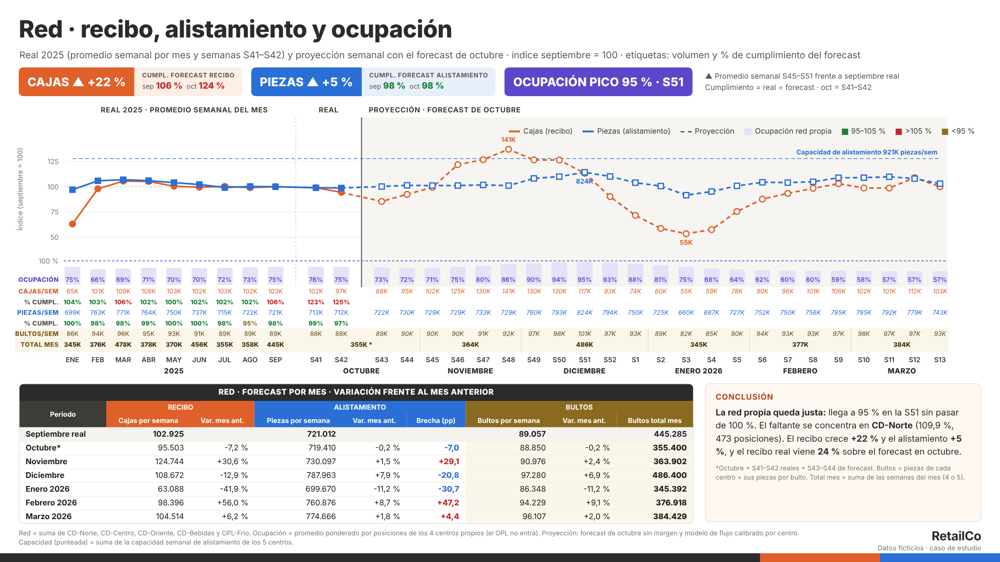
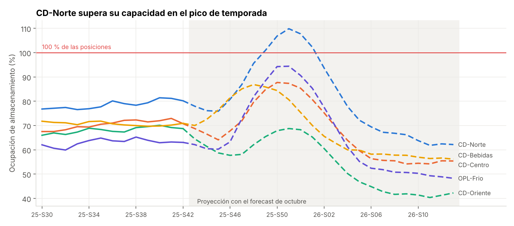
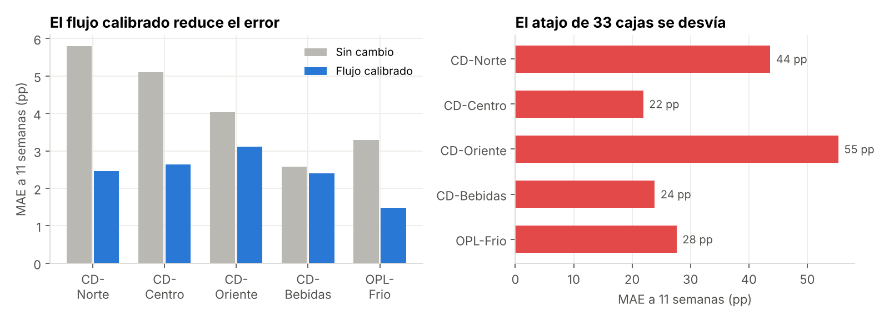
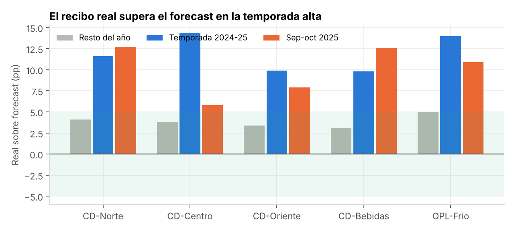
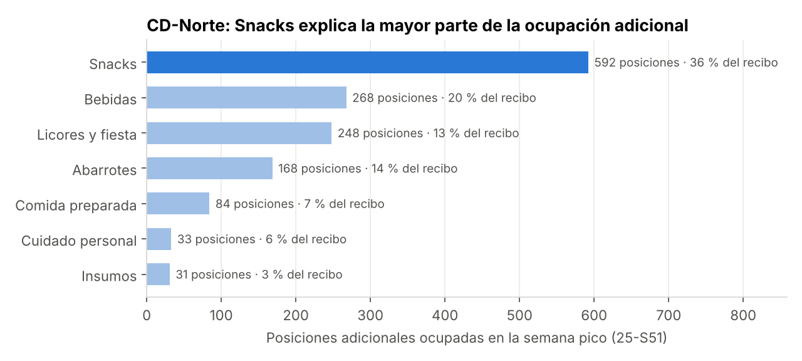

# Capacidad de almacenamiento para la temporada alta

Proyección semanal de la ocupación de 5 centros de distribución de una cadena de retail en la temporada alta (S43 2025 – S13 2026), con un modelo de flujo calibrado y validado contra el histórico, para decidir cuántas posiciones adicionales pedir. Caso de estudio de supply chain y S&OP.

**Resultado principal:** solo CD-Norte se queda sin espacio. Llega a 109,9 % de ocupación en la S51 y le faltan 473 posiciones; si el recibo vuelve a superar el forecast como en septiembre y octubre, la necesidad sube a entre 950 y 1.450 posiciones. El atajo que proponía la gerencia (33 cajas por ubicación) se equivoca entre 22 y 55 puntos de ocupación.

[Ver el notebook](analisis_capacidad.ipynb) · [Abrir en Google Colab](https://colab.research.google.com/github/fvt1999pipe-eng/capacidad_cedis_temporada/blob/main/analisis_capacidad.ipynb) · [Descargar el modelo en Excel](excel/modelo_capacidad.xlsx)



*Lámina para el comité: recibo y alistamiento indexados a septiembre, ocupación de la red propia, cumplimiento del forecast, bultos y resumen mensual. Se genera con [`reportes/lamina_nacional.py`](reportes/lamina_nacional.py) a partir de las tablas del notebook.*

## Contexto y objetivo

El caso se basa en un análisis real que preparé para un comité S&OP de capacidades. La empresa (RetailCo), los centros y todos los datos son **ficticios**: se generaron para este proyecto y no corresponden a ninguna compañía.

RetailCo es una cadena de tiendas de conveniencia abastecida por 4 centros de distribución propios y 1 operador logístico (OPL) de frío. En temporada alta el **recibo** (cajas que entran) crece mucho más que el **alistamiento** (piezas que salen a tiendas), y la bodega se llena con inventario de temporada. El comité necesitaba decidir antes de noviembre si pedía posiciones adicionales, cuántas y para qué centros, con un método que se pudiera defender.

## Preguntas de negocio

1. ¿Qué tan preciso es el forecast de recibo y de alistamiento?
2. ¿Cuánto crecen el recibo y el alistamiento en temporada?
3. ¿Qué método reproduce mejor la ocupación histórica, y con qué error?
4. ¿Sirve el atajo de 33 cajas por ubicación?
5. ¿Qué ocupación tendrá cada centro, cuándo es el pico y cuántas posiciones faltan?
6. ¿Alcanza la capacidad de alistamiento?
7. ¿Qué categoría explica el aumento de ocupación en el centro más crítico?
8. ¿Cómo cambia la decisión entre versiones del forecast?

## Resultados

| Pregunta | Hallazgo | Recomendación |
|---|---|---|
| Precisión del forecast | El alistamiento real queda entre 97 % y 101 % del forecast. El recibo real lo supera entre 10 % y 14 % en la temporada pasada y entre 6 % y 13 % en septiembre y octubre de 2025. | Conciliar con Planeación el forecast de recibo de temporada. |
| Crecimiento de temporada | En la red el recibo crece 21,6 % frente a septiembre y el alistamiento 5,3 %: la bodega acumula 16,2 puntos de brecha. | Planear el espacio con el recibo, no con la demanda. |
| Método | El flujo calibrado tiene un error de 1,5 a 3,1 puntos a 11 semanas, frente a 2,6 a 5,8 del supuesto "sin cambio". | Usar el flujo calibrado y repetirlo con cada versión del forecast. |
| Atajo de 33 cajas | Error de 22 a 55 puntos, siempre por encima: una caja no equivale a un bulto (1,07 a 1,21) y una posición guarda entre 47 y 95 cajas, no 33. | Descartar el atajo. |
| Proyección | CD-Norte llega a 109,9 % en la S51 y le faltan 473 posiciones durante 5 semanas. Con +10 % de recibo, 130,3 % y 1.457 posiciones; CD-Centro y el OPL-Frio también pasan de 100 %. | Contratar entre 950 y 1.450 posiciones para CD-Norte entre la S48 y la S03; contingencia para CD-Centro y el OPL. |
| Alistamiento | El cubrimiento mínimo semanal va de 100,5 % a 110,8 %. | La limitante es el almacenamiento, no el alistamiento. |
| Categorías | En CD-Norte, Snacks ocupa 592 posiciones adicionales en el pico: más que todo el faltante base. | Trasladar Snacks primero a la bodega adicional. |
| Versiones | Con la versión de septiembre CD-Norte llegaba a 86,1 % y no tenía faltante; la de octubre subió su recibo 13 %. | Recalcular la proyección cada vez que cambie el forecast. |



*Ocupación real hasta la S42 y proyección con el forecast de octubre. CD-Norte supera el 100 % de la S49 a la S01.*



*Backtest a 11 semanas con 31 arranques por centro. El flujo calibrado reduce el error; el atajo de 33 cajas sobrestima en todos los centros.*



*El recibo real supera el forecast en temporada, más que el resto del año (la franja verde marca ±5 %).*



*Reparto del aumento de posiciones de CD-Norte en la S51 según el neto acumulado de cada categoría.*

### Limitaciones

- El modelo supone que la relación entre recibo, alistamiento y ocupación se mantiene en temporada. No modela traslados, bajas ni otros ajustes operativos.
- La sensibilidad aplica el mismo porcentaje de recibo adicional a todos los centros y solo en la rampa (S43–S51).
- El reparto por categoría supone equilibrio entre entradas y salidas en octubre. Con la ocupación real por categoría del sistema de almacenamiento (WMS), el cálculo sería directo.
- Los datos son sintéticos: las cifras ilustran el método, no una operación real.

## Datos

| Archivo | Filas | Contenido |
|---|---|---|
| `historico_semanal.csv` | 477 | Recibo y alistamiento (forecast y real) y ocupación por centro y semana, S1 2024 – S42 2025 |
| `forecast_temporada.csv` | 128 | Forecast de temporada por centro, categoría y métrica en formato ancho (una columna por semana), versiones de septiembre y octubre |
| `centros_distribucion.csv` | 5 | Tipo, posiciones, cajas por estiba, piezas por bulto y capacidad semanal de alistamiento |
| `retailco.db` | 3 tablas | Las mismas tablas en SQLite |

El histórico trae, a propósito, problemas de un archivo operativo real: nombres de centro escritos de varias formas, duplicados, ocupación en dos escalas, semanas sin dato, un hueco de recibo y valores sospechosos. El notebook documenta qué se decidió con cada uno.

## Metodología

1. **Calidad de los datos (pandas):** unificación de nombres y escalas, duplicados, imputación marcada de huecos y señalización de datos sospechosos; el forecast pasa de formato ancho a largo.
2. **Precisión del forecast (SQL):** cumplimiento real ÷ forecast por centro, mes y periodo, con semáforo.
3. **Crecimiento de temporada:** variación de recibo y alistamiento frente a septiembre y brecha entre los dos.
4. **Modelo de flujo:** `ocupación(t) = ocupación(t−1) + a × cajas(t) − b × piezas(t)`, con `a` y `b` estimados por mínimos cuadrados sin intercepto para cada centro.
5. **Backtest:** proyección a 11 semanas desde cada semana del histórico con parámetros calibrados solo con datos anteriores; MAE y sesgo frente al supuesto "sin cambio" y al atajo de 33 cajas por ubicación.
6. **Proyección y sensibilidad:** ocupación semanal S43–S13 con el forecast de octubre, posiciones faltantes y escenarios con +5 % y +10 % de recibo.
7. **Alistamiento, categorías y versiones:** cubrimiento de la capacidad, reparto del aumento de posiciones por categoría y comparación de versiones del forecast.

El [modelo en Excel](excel/modelo_capacidad.xlsx) reproduce la proyección con fórmulas (2.890, sin errores). Cambiando el recibo adicional en `Parametros!C4`, el semáforo se recalcula.

## Estructura del repositorio

```
capacidad_cedis_temporada/
├── analisis_capacidad.ipynb   Notebook con el análisis completo
├── data/                      Datos sintéticos (CSV y SQLite)
├── excel/modelo_capacidad.xlsx  Modelo de proyección con fórmulas
├── reportes/                  Lámina ejecutiva (script, HTML y PNG en img/)
├── outputs/                   Tablas finales del análisis
├── img/                       Gráficos
├── requirements.txt
└── README.md
```

## Cómo reproducir el análisis

```bash
git clone https://github.com/fvt1999pipe-eng/capacidad_cedis_temporada.git
cd capacidad_cedis_temporada
pip install -r requirements.txt
jupyter notebook analisis_capacidad.ipynb
```

El notebook lee los archivos de `data/` y escribe las tablas en `outputs/` y los gráficos en `img/`. La lámina ejecutiva se regenera con `python reportes/lamina_nacional.py` (la imagen requiere Playwright con Chromium).

## Herramientas

Python · pandas · NumPy · Matplotlib · SQL (SQLite) · Excel · HTML/SVG · Jupyter

## Autor

**Felipe Vásquez Torres**, analista de datos con experiencia en supply chain y operaciones.

[LinkedIn](https://www.linkedin.com/in/felipe-vasquez-torres) · [Portafolio](https://fvt1999pipe-eng.github.io) · fe.vasqueztorres@gmail.com
